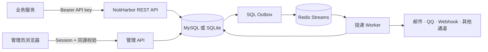

<div align="center">
  <h1>讯港 · NotiHarbor</h1>
  <p><strong>A Reliable, Self-Hosted Notification Gateway</strong><br>可靠、自托管的统一消息通知网关</p>
  <p>
    <a href="https://github.com/jung233/NotiHarbor"></a>
    
  </p>
  <p>
    <a href="#功能一览">功能</a> ·
    <a href="#快速部署">快速部署</a> ·
    <a href="#发送一条通知">API 示例</a> ·
    <a href="#文档导航">文档</a>
  </p>
</div>

**Noti** 取自 *Notification*，**Harbor** 是港口。讯港把来自应用和自动化任务的通知汇聚到一个自托管入口，再按来源权限和投递策略送往已配置的消息通道。你可以自己管理数据、通道凭据、目标和通知记录。

NotiHarbor 是基于 JustSong 的 Message Pusher 源码独立衍生的项目，保留原有 `/push/{username}` 等兼容入口，并增加面向服务集成的统一通知 API 与持久化队列。

## 功能一览

- **统一通知 API**：通过带 scope 的 Bearer API key 创建、查询、重试、取消和重发通知；支持请求幂等键、来源级限流及按 source 隔离数据。
- **可靠异步投递**：SQL 事务同时写入通知、投递和 outbox；Redis Streams 唤醒 worker。系统记录每次发送尝试、重试时间和错误分类，并区分已接受、失败与结果未知等状态。
- **灵活路由**：一次通知可投递到多个已授权通道，采用 `broadcast` 或 `fallback` 策略；优先级按 `critical/urgent`、`high`、`normal`、`low` 调度。
- **Web 管理界面**：管理来源、API key、目标和通道，查看通知历史、投递详情、尝试记录、Dashboard 与审计日志，并发送有审计记录的通道测试消息。
- **现有入口兼容**：保留旧版 Web 管理界面、`/push/{username}` 接口和消息状态查询。Redis 队列启用时，旧异步推送继续返回原有 HTTP 200 与 uuid 响应。
- **自托管存储**：支持 MySQL，也保留 SQLite；网关队列和跨实例限流使用 Redis。支持单容器应用部署，数据库、Redis 与 HTTPS 反向代理由部署环境提供。

### 消息通道

通道能力取决于具体服务商及其账号权限。当前代码包含：

| 类型 | 通道 |
| --- | --- |
| 邮件与 Webhook | SMTP 邮件、自定义 HTTPS Webhook |
| QQ 与微信 | QQ 官方 Bot v2、微信测试号、企业微信应用与群机器人 |
| 飞书与钉钉 | 飞书自建应用与群机器人、钉钉群机器人 |
| 其他适配器 | Bark、Telegram、Discord、OneBot、腾讯云告警、WebSocket 客户端 |
| 路由组合 | 用户配置的通道组；可用能力由其中各个通道决定 |

QQ Bot v2 支持 C2C 和群聊普通主动发送，也支持依赖已验签回调上下文的被动回复。主动发送仍受机器人权限、目标关系和平台限额约束。各适配器的配置细节见[通道指南](#文档导航)。

### 架构概览



SQL 是通知与投递状态的权威记录。Redis 提供异步调度，短暂的 Redis 中断不会丢失已经提交到 SQL outbox 的任务。发送结果无法确认时会记录为 `delivery_unknown`；外部服务不提供通用的 exactly-once 保证，因此不自动重发这类结果。

## 和原 Message Pusher 源码的关系

| 能力 | 原始源码中的入口 | NotiHarbor 当前行为 |
| --- | --- | --- |
| 推送请求 | `/push/{username}`，以用户和通道配置路由 | 保留兼容入口，并提供 `/api/v1/notifications` 统一 API |
| 异步消息 | 保存旧版 Message 并通过 uuid 查询状态 | 保留旧响应；网关队列启用时，在同一事务中关联通知、投递和 outbox |
| 集成身份 | 旧接口的用户 token 与通道 token | 新 API 使用绑定到 source 的 API key 和 scope；key 只保存摘要 |
| 投递诊断 | 旧消息状态和历史列表 | 增加 delivery/attempt、重试、结果未知、审计及按 source 查询 |
| 通道 | 已有同步通道适配器和 Web 管理界面 | 继续复用兼容通道，同时由网关统一安排异步投递 |

此表比较的是原始 Message Pusher 源码中可见的接口与 NotiHarbor 当前代码，不代表对其他通知产品的功能或性能评价。

## 快速部署

需要 Docker Compose v2，以及可从应用容器访问的 MySQL 和 Redis。Compose 只运行 NotiHarbor 应用容器，不会创建数据库或 Redis。先在 MySQL 中创建数据库和应用用户；应用启动时会迁移表结构，但不会创建数据库本身。MySQL 和 Redis 必须加入同一个 Docker 网络；Redis 是网关异步投递和限流所需服务。若省略 `SQL_DSN`，程序可使用 `/data/message-pusher.db` 中的 SQLite；多实例部署建议使用 MySQL。

从仓库目录复制并编辑环境文件：

```bash
cp .env.example .env
openssl rand -base64 48  # 填入 SESSION_SECRET
openssl rand -base64 32  # 填入 ENCRYPTION_KEY
```

将生成的值、唯一的 `INITIAL_ADMIN_PASSWORD`、MySQL/Redis 凭据和公开 HTTPS 地址写入 `.env`。初始管理员密码至少 12 个字符。示例 Compose 会从当前 checkout 构建本地 `notiharbor:local` 镜像；这不依赖预先发布的容器镜像。

```bash
docker network create notiharbor-net
# 将已有 MySQL 与 Redis 容器连接到 notiharbor-net，并在 .env 中填写其网络地址。
mkdir -p data
sudo chown 10001:10001 data
docker compose up -d --build
curl --fail http://127.0.0.1:3000/healthz
curl --fail http://127.0.0.1:3000/readyz
```

Compose 将应用端口仅绑定到宿主机 loopback。配置 HTTPS 反向代理后，把 `APP_PUBLIC_URL` 设为面向用户的 HTTPS URL，并且只把实际代理地址填入 `TRUSTED_PROXIES`。首次登录后配置通道、创建 source，并为该 source 创建带所需 scope 的 API key；把要使用的通道加入 source 的授权列表。API key 的明文只在创建或轮换时显示一次。

凭据升级前请备份数据库，并保存同一把 `ENCRYPTION_KEY`。程序启动时会迁移现有凭据并加密通道 Secret/Token 与敏感系统设置；回滚旧版需要同时恢复升级前数据库备份。详细步骤见[迁移指南](docs/migration.md)。

## 发送一条通知

先在管理界面创建 source 和 API key。确保该 source 已获准使用通道 `12`，且通道已启用；需要具体收件人的通道也应预先配置默认目标。然后从服务端调用：

```bash
NOTIHARBOR_URL="https://notify.example.net"
NOTIHARBOR_API_KEY="在创建时复制的 API key"

curl --fail-with-body --request POST "$NOTIHARBOR_URL/api/v1/notifications" \
  --header "Authorization: Bearer $NOTIHARBOR_API_KEY" \
  --header "Idempotency-Key: invoice-2026-0042" \
  --header "Content-Type: application/json" \
  --data '{
    "title": "付款已完成",
    "content": "订单 42 已付款。",
    "priority": "normal",
    "message_type": "text",
    "channels": ["12"],
    "delivery_policy": "broadcast",
    "metadata": {"order_id": "42"}
  }'
```

首次成功提交返回 HTTP `202`，表示通知已持久化并等待后续投递；相同 source、相同幂等键和相同请求再次提交返回原通知（HTTP `200`）。相同幂等键配上不同请求内容会返回 `409 Conflict`。如果省略幂等键，服务端会生成一个并在响应中返回。状态查询、attempt 详情、批量重试和管理 API 见[统一 REST API](docs/gateway-api.md)及[OpenAPI 描述](docs/openapi.yaml)。

不要把 API key 或通道凭据放在 URL、查询参数或日志中。建议将 key 存放在部署平台的 secret store，并仅授予业务所需 scope。

## 文档导航

| 文档 | 内容 |
| --- | --- |
| [统一 REST API](docs/gateway-api.md) | 上游接口、管理端点、认证与幂等语义 |
| [OpenAPI 3.1](docs/openapi.yaml) | 机器可读 API 描述 |
| [系统架构](docs/architecture.md) | SQL、outbox、Redis worker 与通道关系 |
| [队列和重试](docs/queue-and-retry.md) | 状态、路由、重试、结果未知及日志保留 |
| [部署指南](docs/deployment.md) | Docker Compose、环境变量、反向代理和运行边界 |
| [迁移指南](docs/migration.md) | 数据备份、凭据加密迁移与回滚 |
| [安全配置](docs/security.md) | Session、CSRF、密钥和网络边界 |
| [QQ Bot v2](docs/qqbot-setup.md) | 主动发送、回调、OpenID 和平台限制 |
| [SMTP](docs/smtp-setup.md) | 系统及单通道邮件配置 |
| [自定义 Webhook](docs/webhook-setup.md) | HTTPS 目标、请求模板和网络安全限制 |
| [旧版 API 与 WebSocket](docs/API.md) | 兼容接口和客户端连接协议 |

## 来源、版权与许可证

感谢 JustSong 开源 [Message Pusher](https://github.com/songquanpeng/message-pusher)，其源码为 NotiHarbor 的基础。**NotiHarbor（讯港）是独立衍生项目，并非原项目的官方版本。**原项目的 MIT 许可证及 `Copyright (c) 2022 JustSong` 声明原样保留在 [`LICENSE`](LICENSE) 中；本项目继续遵守该许可证及其版权声明要求。

## License

本仓库按 MIT License 发布。请阅读仓库中的 [`LICENSE`](LICENSE)，其中保留原项目版权与完整许可文本。
