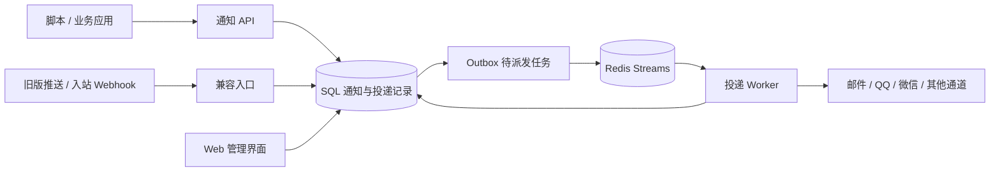

<div align="center">

# 讯港 · NotiHarbor

**让应用的每一条通知，都有统一的出口和可追溯的去向。**

自托管消息通知网关 · 多通道投递 · 持久化队列 · 可视化管理

[](LICENSE)
[](go.mod)
[](web/package.json)

[开始部署](#部署方法) · [功能与通道](#功能与通道) · [第一条通知](#发送第一条通知) · [功能对比](#与-message-pusher-的功能对比) · [文档索引](#文档索引)

</div>

## 项目介绍

**NotiHarbor（讯港）**把脚本、业务系统和自动化平台发出的消息汇集到同一个入口，再送往邮件、QQ、微信、飞书、钉钉等通道。业务端只需调用通知 API，通道凭据、收件目标、失败处理和发送记录都由讯港集中管理。

名字中的 **Noti** 来自 Notification，**Harbor** 意为港口：消息从不同应用抵达，在这里分流、投递，并留下可查询的记录。前端和后端可打包在同一个 Go 程序中，数据与服务由你自行托管。

本项目基于 [JustSong / Message Pusher](https://github.com/songquanpeng/message-pusher) 衍生，保留原有推送接口和管理能力，并增加面向应用集成的通知网关。当前项目仓库为 [jung233 / NotiHarbor](https://github.com/jung233/NotiHarbor)，是独立维护的衍生项目。

### 适合哪些场景？

| 场景 | 可以怎样使用 |
| --- | --- |
| 运维与监控告警 | 将服务异常、备份失败、证书提醒发送到群聊或邮箱，查询失败原因并人工补发。 |
| 定时任务与个人自动化 | 在爬取、下载、数据处理、NAS 任务结束时推送结果，无需在每个脚本里维护机器人凭据。 |
| 业务事件通知 | 按订单、工单或任务生成幂等键，降低接口重试造成的重复入队。 |
| CI/CD 与团队协作 | 汇集构建、测试、发布结果，通过多个通道广播，或按顺序尝试备用通道。 |
| 多应用共享通知服务 | 为每个应用建立独立来源、API key、通道授权和限流规则，分别查看记录。 |
| 既有 Message Pusher 集成 | 保留 `/push/{username}` 调用方式，逐步迁移到统一 REST API。 |

## 功能与通道

### 从接入到排查

- **统一接入**：REST API 支持创建、查询、重试、批量重试、取消和重发通知，也可查询通道及发送测试消息。保留旧版 GET/POST 推送接口和入站 Webhook 转换入口。
- **来源与权限**：每个来源（source）拥有独立 API key、可用通道和限流配置；key 支持权限范围（scope）、过期、轮换与撤销，服务端只保存摘要。
- **收件目标管理**：按来源和通道保存目标、外部标识及默认目标，让调用方复用已配置的收件人。
- **多通道路由**：`broadcast` 向选定通道广播；`fallback` 依次尝试备用通道。支持 `critical/urgent`、`high`、`normal`、`low` 优先级调度。
- **持久化与恢复**：通知和投递任务写入 SQL 后再异步发送；SQL outbox 配合 Redis Streams、worker 租约与任务回收，处理服务重启和短暂故障。
- **失败处理**：按错误类型安排退避重试，记录尝试次数和下次重试时间；达到上限后保留终止记录，支持人工处理。
- **可视化管理**：Dashboard 展示当天统计、24 小时趋势、通道成功率与耗时；历史页支持搜索和筛选，详情页查看每个通道的投递及尝试记录。
- **日志与审计**：查看投递错误和管理操作，通道测试也保留记录；投递尝试与审计日志可按保留天数清理。
- **账号与站点管理**：保留多用户、角色权限、个人设置、密码找回、邮箱绑定、GitHub OAuth、微信认证接入及 Turnstile 配置；支持公告、关于页面、页脚与首页链接设置。第三方登录等能力需管理员配置后启用。
- **部署与保护**：支持 MySQL / SQLite、Cookie / Redis Session、敏感凭据加密、浏览器同源校验、请求限流、健康及就绪检查。

### 支持的消息通道

以下列出当前可配置的全部通道类型。能发送的内容格式、收件对象与频率，以适配器配置和对应平台权限为准。

| 通道 | 用途与说明 |
| --- | --- |
| SMTP 邮件 | 发送邮件，可使用系统 SMTP 或通道独立配置。 |
| QQ 官方 Bot v2 | C2C、群聊，支持文本与 Markdown；可主动发送，也可基于已验签回调上下文被动回复。 |
| 微信测试号 | 通过微信公众号测试号推送。 |
| 企业微信应用号 | 使用企业自建应用向成员发送通知。 |
| 企业微信群机器人 | 通过群机器人 Webhook 推送。 |
| 飞书群机器人 | 向飞书群发送通知。 |
| 飞书自建应用 | 使用应用身份发送消息。 |
| 钉钉群机器人 | 向钉钉群发送通知。 |
| Bark | 向 Bark 客户端发送通知。 |
| WebSocket 客户端 | 向已注册、已连接的客户端推送消息。 |
| Telegram 机器人 | 使用 Telegram Bot 发送消息。 |
| Discord 群机器人 | 通过 Discord Webhook 推送。 |
| OneBot 协议 | 接入兼容 OneBot 的消息服务，包括相应 QQ 集成。 |
| 自定义消息通道 | 通过可配置的 HTTPS Webhook、请求头与请求体对接其他服务。 |
| 群组消息 | 将多个已有通道组合使用。 |
| 腾讯云消息告警 | 对接腾讯云告警消息通道。 |
| 不推送 | 接收并按配置保存消息，不向外部通道发送。 |

> **投递状态的含义**：HTTP `202` 表示通知已经持久化、等待投递；通道接受请求也不等于收件人已阅读。若外部服务可能已接收但返回结果无法确认，系统记录为 `delivery_unknown`，默认留待人工确认，避免自动重发造成重复。不同适配器提供的回执与错误信息详细程度有所不同。

QQ 主动发送受平台权限、用户或群关系以及额度限制；被动回复依赖真实回调产生的有效上下文。文本、Markdown、模板等能力也受机器人权限约束，详见 [QQ Bot 配置](docs/qqbot-setup.md)。

### 消息如何流转



上图展示 Redis 网关启用后的异步投递路径；旧版同步调用仍按原接口执行。SQL 保存通知及投递状态，Redis 负责调度。已经提交到 SQL outbox 的任务可在 Redis 恢复后继续派发；备份时仍应保护数据库、密钥及部署配置。

## 部署方法

### 方式一：Docker Compose + 已发布镜像（推荐）

项目已发布 [v0.5.2 Release](https://github.com/jung233/NotiHarbor/releases/tag/v0.5.2)，可直接拉取 **`ghcr.io/jung233/notiharbor:v0.5.2`**，无需在部署机器上编译前后端。镜像支持 **`linux/amd64` 与 `linux/arm64`**；另有持续更新的 `latest` 标签，正式部署建议固定版本。

你需要准备 Docker Compose v2、可用的 Redis，以及 MySQL 或 SQLite 存储。仓库的 Compose 仅启动讯港应用。MySQL、Redis 容器需接入应用使用的同一个 Docker 网络；外部服务则需确保网络可达。

下面的命令以 Linux / Bash 为例。

**1. 获取项目，准备配置**

```bash
git clone git@github.com:jung233/NotiHarbor.git
cd NotiHarbor
cp .env.example .env

# 分别生成 Session 密钥和凭据加密密钥，复制到 .env 对应字段
openssl rand -base64 48
openssl rand -base64 32
```

没有配置 GitHub SSH key 时，可将克隆地址改为 `https://github.com/jung233/NotiHarbor.git`。

编辑 `.env`，至少完成以下配置：

| 配置 | 如何填写 |
| --- | --- |
| `NOTIHARBOR_IMAGE` | 改为 `ghcr.io/jung233/notiharbor:v0.5.2`，使用已发布镜像。示例文件默认的 `notiharbor:local` 用于源码构建。 |
| `DOCKER_NETWORK` | 已存在的 Docker 网络名称，例如 `notiharbor-net`。 |
| `SQL_DSN` | MySQL 连接串：`user:password@tcp(mysql:3306)/notiharbor?charset=utf8mb4&parseTime=True&loc=UTC`。请先创建数据库并授予应用用户权限；程序只迁移表结构。 |
| `REDIS_CONN_STRING` | Redis 地址及凭据，例如 `redis://:password@redis:6379/0`。 |
| `SESSION_SECRET` | 上面生成的第一项，至少 32 字节；重启和多实例使用同一值。 |
| `ENCRYPTION_KEY` | 上面生成的第二项，必须是 32 个随机字节的 Base64 编码；妥善保存。 |
| `INITIAL_ADMIN_USERNAME` / `INITIAL_ADMIN_PASSWORD` | 首次创建管理员的用户名和独立密码，密码至少 12 个字符。示例用户名为 `admin`。 |
| `APP_PUBLIC_URL` | 浏览器实际访问的完整地址，例如 `https://notify.example.net`。 |
| `COOKIE_SECURE` | HTTPS 部署设为 `true`；仅本机 HTTP 试用时设为 `false`，并同时将公开地址改成 `http://localhost:3000`。 |
| `TRUSTED_PROXIES` | 使用反向代理时填写实际代理 IP / CIDR，多个值用逗号分隔；不使用时留空。 |

**想先用 SQLite？** 将 `.env` 中的 `SQL_DSN` 留空，Compose 会把 SQLite 数据库保存到挂载目录内的 `/data/message-pusher.db`。Redis 仍是统一通知网关的必要依赖。多实例部署建议使用 MySQL。

**2. 准备网络与持久化目录**

```bash
# 网络已存在时跳过创建
docker network create notiharbor-net

# 仅在已有服务容器尚未加入该网络时执行；将名称替换为实际容器名
docker network connect notiharbor-net mysql
docker network connect notiharbor-net redis

mkdir -p data
sudo chown 10001:10001 data
```

网络名应与 `.env` 一致。使用 SQLite 时无需 MySQL 容器。应用以 UID/GID `10001:10001` 运行，挂载目录必须可写；Windows / Docker Desktop 按宿主机文件共享权限设置即可。

**3. 拉取、启动并检查**

```bash
docker compose pull notiharbor
docker compose up -d --no-build notiharbor
docker compose ps
docker compose logs --tail=100 notiharbor

curl --fail http://127.0.0.1:3000/healthz
curl --fail http://127.0.0.1:3000/readyz
```

默认端口只绑定宿主机 `127.0.0.1:3000`，可通过 `HOST_PORT` 调整。`/healthz` 检查 HTTP 服务，`/readyz` 还检查网关、SQL 和 Redis；两者都通过后再进行业务接入。

Compose 文件保留了源码构建配置，因此镜像部署时使用 `--no-build`。若 GHCR 包访问受限，请先用有 `read:packages` 权限的账号执行 `docker login ghcr.io`。

**4. 配置访问地址并登录**

公网使用时，让 Nginx、Caddy 等反向代理将 HTTPS 请求转发到应用端口，并确认 `.env` 的 `APP_PUBLIC_URL` 与访问地址一致。随后用初始管理员账号登录。还应在系统设置中将**服务器地址**设为同一公开地址，用于生成消息及密码找回链接；它与环境变量中的浏览器访问地址需要分别配置。

首次账号创建完成后，修改 `INITIAL_ADMIN_PASSWORD` 不会重置普通已有账号的密码；后续请在界面中修改。完整环境变量、代理及运行配置见 [部署指南](docs/deployment.md)。

### 方式二：直接使用 Docker 镜像

不使用 Compose 时，也可以直接 `docker run`。先按上文准备 `.env`、Docker 网络和可写的 `data` 目录，再执行以下命令。此示例使用默认网络和目录；如已更改配置，请同步调整参数。

```bash
docker pull ghcr.io/jung233/notiharbor:v0.5.2

docker run -d \
  --name notiharbor \
  --restart unless-stopped \
  --init \
  --stop-timeout 30 \
  --network notiharbor-net \
  --env-file .env \
  --env PORT=3000 \
  --env SQLITE_PATH=/data/message-pusher.db \
  --publish 127.0.0.1:3000:3000 \
  --mount "type=bind,source=$(pwd)/data,target=/data" \
  ghcr.io/jung233/notiharbor:v0.5.2

docker logs --tail=100 notiharbor
curl --fail http://127.0.0.1:3000/readyz
```

此方式与 Compose 部署二选一，避免容器名或端口冲突。数据库、Redis、公开地址、初始管理员和密钥要求相同；镜像内已包含前端资源。

### 方式三：从源码构建

需要使用当前分支的改动时，可直接由 Docker 完成构建。沿用上文配置，将 `.env` 中的 `NOTIHARBOR_IMAGE` 改为 `notiharbor:local`，然后执行：

```bash
docker compose up -d --build notiharbor
```

也可以自行编译二进制，适合自行管理进程或调试代码的环境。准备 **Go 1.26、Node.js 20、npm**，以及 SQLite 驱动编译所需的 C 编译器。前端构建结果会嵌入 Go 二进制中，必须先构建前端。

```bash
cd web
npm ci --ignore-scripts --no-audit --no-fund
PUBLIC_URL=/ npm run build
cd ..

CGO_ENABLED=1 go build -trimpath -o notiharbor .
```

在进程管理器或运行环境中设置上表的应用环境变量，然后启动：

```bash
./notiharbor --port 3000 --log-dir ./logs
```

`DOCKER_NETWORK`、`HOST_PORT`、`DATA_DIR` 和 `NOTIHARBOR_IMAGE` 仅供 Compose 使用。源码运行时，SQLite 路径用 `SQLITE_PATH` 指定，监听端口可用 `PORT` 或 `--port` 设置；使用 MySQL / Redis 时填写宿主机可访问的地址。

### 更新与备份

更新前备份数据库、`.env` 和持久化目录，保存原来的 `ENCRYPTION_KEY`。镜像部署时，先查看 [Release](https://github.com/jung233/NotiHarbor/releases) 并将 `.env` 中的 `NOTIHARBOR_IMAGE` 改为目标版本，然后拉取并重建应用容器：

```bash
docker compose pull notiharbor
docker compose up -d --no-build notiharbor
curl --fail http://127.0.0.1:3000/readyz
```

直接 `docker run` 部署时，拉取目标镜像后停止旧容器，并用原来的环境变量、网络和数据挂载重新创建。源码部署则先执行 `git pull --ff-only origin main`，再重新构建和启动。

从旧版升级时，程序会迁移数据表并加密已有通道 Secret / Token 及敏感系统设置。**不要随意更换加密密钥**，否则已有凭据无法解密；回滚旧版应同时恢复升级前的数据库备份。步骤见 [迁移指南](docs/migration.md)。

## 发送第一条通知

先在 Web 界面完成四件事：

1. **添加并启用通道**，填好该平台的凭据和发送配置。
2. 在网关的**来源管理**中创建来源，把该通道加入允许使用的列表。
3. 按通道需要创建**收件目标**，设置默认目标。
4. 为来源创建 API key，授予 `notifications:write` 和 `notifications:read`，保存仅显示一次的明文。

将下面的地址、key 和通道 ID 替换为实际值，从服务端或本机终端调用：

```bash
NOTIHARBOR_URL="https://notify.example.net"
NOTIHARBOR_API_KEY="替换为刚创建的 API key"

curl --fail-with-body "$NOTIHARBOR_URL/api/v1/notifications" \
  --header "Authorization: Bearer $NOTIHARBOR_API_KEY" \
  --header "Idempotency-Key: backup-2026-10-15" \
  --header "Content-Type: application/json" \
  --data '{
    "title": "备份完成",
    "content": "数据库备份已完成，可以在备份服务器查看结果。",
    "priority": "normal",
    "message_type": "text",
    "channels": ["12"],
    "delivery_policy": "broadcast",
    "metadata": {"job": "daily-backup"}
  }'
```

成功后返回 `notification_id`，可在网关历史页查看，或调用：

```bash
curl --fail-with-body "$NOTIHARBOR_URL/api/v1/notifications/替换为通知ID" \
  --header "Authorization: Bearer $NOTIHARBOR_API_KEY"
```

| 响应 | 含义 |
| --- | --- |
| `202 Accepted` | 首次提交成功，通知已保存，等待异步投递。 |
| `200 OK` | 同一来源、同一幂等键、相同请求的重复提交，返回已有通知。 |
| `409 Conflict` | 同一幂等键被用于不同的请求内容，需要检查调用方逻辑。 |

每个独立业务事件应使用不同幂等键，重试同一事件时复用原键。省略时服务端会生成并返回一个键。API key 应放在服务端环境变量或密钥管理服务中，不应写入浏览器代码、URL 或公开日志。

## 与 Message Pusher 的功能对比

比较对象是本项目继承的 [Message Pusher 源码基线 `fbbfa58`](https://github.com/songquanpeng/message-pusher/tree/fbbfa58da1b65fc5d92fae083e06bec1701f8df3)，并非对原项目未来版本的判断。下表按使用者可见的功能归类；所有通道另列一表，避免将继承能力误写为新增能力。

### 接入、管理与投递

| 功能 | 原 Message Pusher | NotiHarbor |
| --- | --- | --- |
| GET / POST 推送 | `/push/{username}`，按用户及通道配置推送 | 保留兼容入口；新集成可使用 `/api/v1/notifications`。 |
| Server 酱兼容调用 | 支持兼容请求格式 | 保留旧推送入口的参数兼容。 |
| 同步 / 异步发送 | 支持同步发送、异步队列及 uuid 状态查询 | 保留；启用 Redis 网关后，旧异步请求也关联持久化通知与投递任务，保留原 HTTP 200 / uuid 响应。 |
| 入站 Webhook 转换 | 提取第三方 JSON 字段，按规则构造消息并转发 | 保留规则、入口和管理界面。 |
| 消息编辑与展示 | 网页编辑发送、Markdown / 代码 / 原始内容渲染、消息链接 | 保留；统一 API 接受文本 / Markdown，实际呈现取决于通道。 |
| 消息历史 | 保存、搜索、查看、删除、重发及 SSE 新消息流 | 统一消息中心展示 Webhook、编辑器、旧推送接口及历史消息；按消息去重、筛选和查看投递详情，独立标签展示每次投递尝试。 |
| 通道管理 | 创建、编辑、启停、搜索、删除、通道 token、群组组合 | 保留；新增来源通道授权及带记录的网关测试入口。 |
| WebSocket 客户端 | 注册客户端、连接并接收推送 | 保留兼容协议。 |
| 账号与角色 | 多用户、管理员 / 超级管理员、用户管理、个人资料、token | 保留；来源与网关资源还校验所有权，网关页面通过管理员路由进入。 |
| 登录与验证 | 密码登录、可配置注册、邮箱验证与绑定、密码找回、GitHub OAuth、微信认证、Turnstile | 保留可配置接入；初始管理员改为部署时提供密码。 |
| 站点设置 | SMTP、服务器地址、注册与消息保存 / 渲染开关、公告、关于、页脚、首页链接 | 保留；旧消息保存开关不替代网关的持久化记录。 |
| 应用级身份 | 主要通过用户 token、通道 token 集成 | 新增 source、Bearer API key、scope、过期、轮换、撤销及来源数据隔离。 |
| 收件目标目录 | 通过通道配置、用户信息或请求指定收件人 | 新增按来源和通道维护的目标记录、默认目标及状态管理。 |
| 请求幂等 | 无统一通知幂等资源 | 新 API 按来源和幂等键去重，相同键不同内容返回冲突。 |
| 广播与备用路由 | 通道组可组合多个通道 | 保留通道组；新增网关 `broadcast` / `fallback` 投递策略。 |
| 调度优先级 | 原有消息队列 | 新增通知优先级调度。 |
| 任务持久化 | 旧 Message 状态及异步队列恢复 | 新增 SQL 事务、outbox、Redis Streams、worker 租约及回收。 |
| 自动重试 | 原有异步发送处理 | 新增按投递错误分类、退避、尝试上限、死信状态及结果未知状态。 |
| 人工处理 | 旧消息重发 | 新增通知重试、批量重试、取消待处理投递和创建新通知重发；处理中投递不能直接取消。 |
| 投递诊断 | 消息级状态与历史 | 新增每个通道的 delivery、每次 attempt、错误分类、耗时及可用的平台回执。 |
| 运行统计 | 原有站点及消息信息 | 新增网关 Dashboard、24 小时趋势、积压 / 重试量和通道统计。 |
| 审计与保留 | 原有运行日志 | 新增来源、key、目标、测试、重试等操作审计，以及投递尝试 / 审计日志保留策略。 |
| 请求限流 | 全局 API、网页及关键操作限流，可使用 Redis | 保留；新增基于 Redis 的来源级限流。 |
| 凭据与会话保护 | 原有账号、token 和 Session 认证 | 新增通道及敏感设置加密、API key 摘要、稳定 Session 密钥、Cookie 属性及同源校验；自定义 Webhook 限制 HTTPS 和目标网络。 |
| 数据存储 | SQLite / MySQL，Redis 可用于原有辅助能力 | 保留两种 SQL；统一网关以 Redis 作为异步调度与限流依赖。 |
| 交付与运维 | Go + React、容器及二进制构建 | 延续单程序交付；发布 amd64 / arm64 镜像，支持直接拉取或源码构建、非 root 容器、健康 / 就绪检查与优雅退出。 |

### 全部通道的继承与变化

| 通道 | 原 Message Pusher | NotiHarbor |
| --- | --- | --- |
| SMTP 邮件 | 支持 | 保留，增强发送超时与错误处理。 |
| 微信测试号 | 支持 | 保留。 |
| 企业微信应用号 | 支持 | 保留。 |
| 企业微信群机器人 | 支持 | 保留。 |
| 飞书群机器人 | 支持 | 保留。 |
| 飞书自建应用 | 支持 | 保留。 |
| 钉钉群机器人 | 支持 | 保留。 |
| Bark | 支持 | 保留。 |
| WebSocket 客户端 | 支持 | 保留。 |
| Telegram 机器人 | 支持 | 保留。 |
| Discord 群机器人 | 支持 | 保留。 |
| OneBot 协议（含相应 QQ 集成） | 支持 | 保留。 |
| 自定义消息通道 | 支持 | 保留请求定制，增加 HTTPS / 网络访问限制、超时及错误处理。 |
| 群组消息 | 支持 | 保留；与网关的广播 / 备用路由是两种配置方式。 |
| 腾讯云消息告警 | 支持 | 保留。 |
| 不推送 | 支持 | 保留。 |
| QQ 官方 Bot v2 | 无此专用适配器 | 新增 C2C / 群聊、主动发送、回调验签、被动回复、目标上下文及平台错误处理。 |

旧版通道得以复用，不意味着每个平台都能提供完整回执或相同的重试判断。迁移已有调用前，请按实际通道验证发送结果；旧版兼容 API 与新版 API 的认证、响应和历史记录入口也各有区别。

## 项目结构与目录

```text
NotiHarbor/
├── main.go                 # 启动服务、初始化存储、运行 worker 与退出处理
├── gateway-sender.go       # 将网关投递交给具体通道
├── channel/                # 各平台适配器、客户端、QQ 回调与旧队列
├── gateway/                # 通知服务、路由策略、outbox、调度、重试与审计
├── controller/             # HTTP 接口：通知、账号、通道、Webhook 与管理
├── middleware/             # 认证、Session、同源校验、限流与请求日志
├── model/                  # 数据模型、数据库初始化与迁移
├── router/                 # 网页、兼容 API 与 v1 网关路由
├── common/                 # 配置、加密、邮件、日志、模板等公共能力
│   └── public/             # 服务端消息页面模板与静态样式
├── web/
│   ├── src/pages/Gateway/  # 网关仪表盘、来源、目标、历史、日志与测试页面
│   ├── src/components/     # 登录、设置、表格等界面组件
│   ├── src/helpers/        # API 调用、Session 与显示工具
│   ├── public/             # 前端静态资源
│   └── build/              # 前端构建产物，编译时嵌入 Go 程序
├── docs/                   # API、部署、迁移与通道专题说明
├── bin/                    # 历史版本数据迁移辅助脚本
├── .github/workflows/      # 容器、平台二进制及文档站点构建
├── .env.example            # 部署配置示例
├── Dockerfile              # 前端、Go 多阶段构建及运行镜像
├── docker-compose.yml      # 应用容器、外部网络与持久化挂载
├── go.mod / go.sum         # Go 依赖
└── LICENSE                 # MIT 许可证与原始版权声明
```

通道接入主要看 `channel/`，投递流程看 `gateway/`，HTTP 行为看 `controller/` 与 `router/`，管理界面看 `web/src/`。相关测试与实现放在相应目录中。

## 文档索引

| 想了解什么 | 阅读入口 |
| --- | --- |
| 部署、环境变量与代理 | [部署指南](docs/deployment.md) |
| 接入新通知 API | [统一 REST API](docs/gateway-api.md) · [OpenAPI 描述](docs/openapi.yaml) |
| 继续使用旧推送 / WebSocket | [兼容 API](docs/API.md) |
| QQ、邮件和自定义通道 | [QQ Bot v2](docs/qqbot-setup.md) · [SMTP](docs/smtp-setup.md) · [Webhook](docs/webhook-setup.md) |
| 理解状态与失败处理 | [队列和重试](docs/queue-and-retry.md) · [系统架构](docs/architecture.md) |
| 升级已有实例 | [迁移指南](docs/migration.md) |
| 配置密钥与访问边界 | [安全配置](docs/security.md) |

## 版权声明与致谢

NotiHarbor 按 [MIT License](LICENSE) 发布。仓库保留原项目的 **`Copyright (c) 2022 JustSong`** 及完整许可文本；使用、修改和再分发时，请保留许可证要求的版权与许可声明。

感谢 **[JustSong](https://github.com/songquanpeng)** 开源 [Message Pusher](https://github.com/songquanpeng/message-pusher)，为本项目提供多通道推送、账号体系与 Web 管理的基础；感谢原项目及本项目的贡献者、问题反馈者和测试使用者。

也感谢 [Go](https://go.dev/)、[Gin](https://github.com/gin-gonic/gin)、[GORM](https://gorm.io/)、[Redis](https://redis.io/)、[React](https://react.dev/) 和 [Semantic UI React](https://react.semantic-ui.com/) 等开源项目。各依赖的版权与许可归其权利人所有。

**讯港是独立衍生项目，并非 Message Pusher 官方版本。** QQ、微信、飞书等名称及商标属于各自权利人，列出通道仅说明技术对接能力。软件按许可证以现状提供，具体许可与责任范围请阅读 [LICENSE](LICENSE)。
