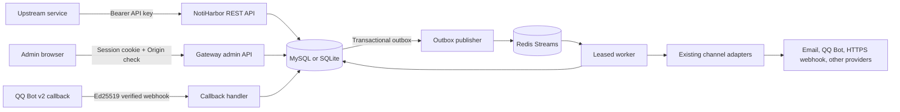

# NotiHarbor 网关架构

NotiHarbor（讯港）在保留原有用户界面、`/push/:username` 兼容 API、通道管理和消息存储的基础上，增加以 source 为边界的通知网关。两套入口共用 SQL 数据库和通道发送适配器；网关还使用 Redis Streams 投递异步通知。

## 请求和持久化

API key 绑定一个 source。source 归属某个用户，并明确列出允许使用的启用通道；其 API key 不能读取或修改其他 source 的通知。key 只以 SHA-256 摘要形式存储，明文只在创建或轮换响应中出现一次。

接收通知时，服务在同一个数据库事务里校验 source、幂等键和通道权限，并创建 notification、delivery 及 outbox 记录。相同 source 和幂等键重复提交相同请求会返回已有 notification；相同键对应不同请求返回冲突。Redis 发布失败时，SQL outbox 保留待发布工作供后台重试。

兼容的 /push/:username?async=true 请求在 Redis 网关队列启用时，也会在一个 SQL 事务内保存旧版 Message 和对应的 notification、delivery、outbox；HTTP 200 与 uuid 旧响应保持不变。旧消息扫描器会跳过已桥接的记录，避免重复投递。

## 投递和回调

Outbox publisher 将待处理 delivery 放入 Redis Stream。worker 使用 consumer group、租约和数据库状态处理任务；Redis 中的消息只负责唤醒 worker，SQL delivery 与 attempt 记录才是投递状态依据。worker 使用已存在的通道适配器，不保存完整 provider 响应正文。

QQ Bot v2 回调按 X-Bot-Appid 找到唯一启用通道，验证签名后以 channel 与 event ID 去重。有效事件可更新该 source 有权使用的通道目标，并为符合平台窗口和次数限制的被动回复提供事件上下文。普通主动投递不携带回调关联字段；它仍须满足机器人和目标对应的平台权限与额度。

## 存储

- MySQL 是生产部署示例使用的数据库；SQLite 仍受支持，主要用于开发、单实例和测试。
- Redis Streams 是网关投递队列及分布式限流的后端；没有 Redis 时旧版页面和同步消息能力可启动，但网关 worker 不会启动，/readyz 返回不可用。
- SESSION_STORE=cookie 将浏览器会话保存在签名 Cookie 中，Redis 仍独立服务队列。它不改变 SESSION_SECRET 的持久化要求。
- SQL 中保存 source、API key 摘要、notification、delivery、attempt、outbox、target、回调事件和审计记录。
- 保留任务默认每小时最多分别清理 500 条符合条件的旧 delivery attempts 和 audit logs；具体范围见[队列和重试](queue-and-retry.md)。
